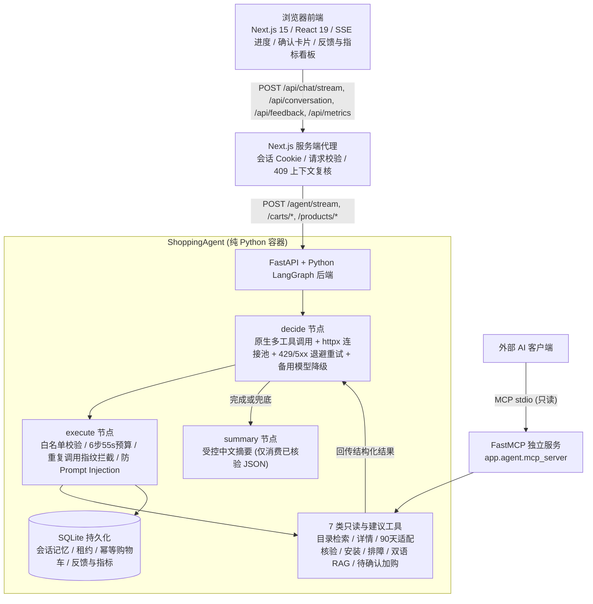

# 家电配件咨询与确认式购物 Agent (Appliance Parts Agent)

[](https://www.python.org/)
[](https://fastapi.tiangolo.com/)
[](https://www.langchain.com/langgraph)
[](https://nextjs.org/)
[](https://modelcontextprotocol.io/)
[](https://www.docker.com/)
[](#验证与评测结果)

面向冰箱与洗碗机维修配件场景的**垂直领域 AI Agent 全栈应用**，采用 **Next.js 15 + React 19（前端交互与会话代理）** 与 **FastAPI + Python LangGraph（纯 Python 智能体编排、检索与持久化）** 前后端分离架构，并提供独立的只读 **MCP（Model Context Protocol）** 服务接口。

项目重点解决大模型在垂类导购落地中的四大工程痛点：**幻觉推荐、型号适配误判、越权写入与长耗时交互体验**。

> 💡 **演示截图位**：本地启动后可将对话流式进度与确认加购界面截图放至 `docs/assets/demo.png` 并在此处取消注释展示。
> <!--  -->

---

## 系统架构



详细分层设计与安全护栏见 [系统架构说明](PartSelectChatAgent/docs/architecture.md)。

---

## 核心工程特性

### 1. 有界 LangGraph 决策与高可用模型调用
- **有界循环与防空转**：单轮严格限制 **6 步调用 / 55 秒预算**，通过工具参数指纹拦截重复调用，配合单次协议修正兜底，杜绝 Agent 死循环。
- **原生多工具调用与容错**：默认采用原生 Function Calling（`tool_choice="required"`、`parallel_tool_calls=False`，真机联调 0 协议修正），配合全局 `httpx.AsyncClient` 连接池、429/5xx 瞬态指数退避重试及备用模型降级切换。

### 2. 全链路 SSE 流式体验与幻觉治理
- **实时过程可见**：通过 `POST /api/chat/stream` → `POST /agent/stream` 实时推送决策与工具执行进度（检索目录 → 核验适配 → 生成摘要），缓解多步调用等待焦虑。
- **确定性事实渲染**：价格、库存、型号与适配状态由确定性工具 JSON 直接渲染卡片；`groundedSummary` 节点仅基于已核验数据生成简洁中文摘要，禁止模型编造或覆写事实。
- **Prompt Injection 拦截**：工具输出显式标记为不可信数据，`execute` 节点严格按只读白名单校验，拦截诱导越权写入的注入指令。

### 3. 中英双语 RAG 与证据严格分层
- **双语检索与越界拒答**：支持动态品牌识别、中英双语领域同义词改写、越界家电/未收录品牌拦截；支持 BM25 及可选本地向量（BGE-small + NumPy + RRF）混合检索。
- **适配证据 90 天有效期**：普通维护知识**不可替代**精确型号适配证明；人工审核适配快照具备 **90 天有效期**，过期或证据冲突时显式返回“未知”，拒绝盲目推荐。

### 4. 确认式购物闭环（Human-in-the-Loop）与可观测性
- **读写权限隔离**：模型仅拥有只读与“生成加购建议”权限，无法直接写库；用户点击确认后，服务端复核价格、库存与当前设备型号上下文，通过 **SQLite 事务 + 幂等键**执行写入；上下文变更或证据失效时返回 **`409 Conflict`** 拦截旧操作。
- **反馈与运行指标看板**：支持单轮点赞/点踩与原因标签持久化回显，侧边栏内置会话指标看板（完成轮次、平均耗时、加购转化漏斗、Token 消耗与反馈统计）。
- **独立只读 MCP 服务**：提供基于 `FastMCP` 的标准协议只读工具接口，供外部 MCP 客户端复用检索能力。

---

## 验证与评测结果

### 1. 自动化测试（共 130 项全通过）

| 模块 | 测试框架 | 结果 | 核心覆盖范围 |
| :--- | :--- | :--- | :--- |
| **后端服务** (`ShoppingAgent`) | `pytest` | **68 / 68 通过** | 证据有效期与冲突校验、原生 Tool Calling 与 503 重试、SSE 流式接口、Prompt Injection 与重复调用防护、40 条双语检索基准、用户反馈与指标、幂等购物车事务 |
| **前端与代理** (`PartSelectChatAgent`) | `npm test` | **62 / 62 通过** | 确认式加购与 409 上下文失效拦截、会话租约与恢复、知识库一致性校验、证据 UI 展示、中文交互适配 |
| **前端生产构建** | `npm run build` | **零报错通过** | Next.js 15 静态类型检查、`knowledge:check`、`/api/chat/stream` 等路由编译 |

### 2. 中英双语检索基准评测（40 条用例）

覆盖 20 条英文正向问法、14 条原生中文问法及 6 条越界家电 / 未收录品牌 / 空查询负样本（完整报告见 [retrieval-benchmark-v2.json](PartSelectChatAgent/evals/reports/retrieval-benchmark-v2.json)）：

| 评测指标 | 实测结果 | 说明 |
| :--- | :--- | :--- |
| `Recall@1` | **97.06%** (33/34) | 正样本 Top-1 命中率 |
| `Recall@3` | **100.0%** (34/34) | 正样本 Top-3 命中率 |
| `MRR` | **0.9804** | 平均倒数排名 |
| **负样本拒答率** | **100.0%** (6/6) | 修复越界通用词误召回后，由 **66.67% → 100.0%** |
| 检索延迟（P50 / P95） | **0.05 ms / 0.09 ms** | 本地 BM25 检索耗时 |

详细联调记录见 [验证与联调报告](PartSelectChatAgent/docs/closeout-report.md)。

---

## 快速启动

### 方式一：Docker Compose（推荐）

1. 复制环境变量模板并填入自己的大模型 API Key（默认兼容阿里云百炼 / OpenAI 协议）：
   ```bash
   cp PartSelectChatAgent/.env.local.example PartSelectChatAgent/.env.local
   ```
2. 在仓库根目录一键构建并启动双服务：
   ```bash
   AGENT_HTTP_PORT=3000 docker compose up -d --build --wait
   ```
3. 浏览器访问 `http://127.0.0.1:3000`（FastAPI 后端仅在容器内网通信，不对外暴露端口）。

### 方式二：本地原生开发启动

1. **启动后端（Python 3.11+）**
   ```bash
   cd ShoppingAgent
   python -m venv .venv
   # Windows: .venv\Scripts\activate  |  Linux/macOS: source .venv/bin/activate
   pip install -e ".[dev]"
   uvicorn app.main:app --host 127.0.0.1 --port 8000
   ```
2. **启动前端（Node.js 22+）**
   ```bash
   cd PartSelectChatAgent
   npm ci
   npm run seed:data
   npm run export:shopping
   npm run knowledge:build
   npm run dev
   ```

### 运行测试、评测与 MCP 验证

```bash
# 后端 68 项单元测试
cd ShoppingAgent && python -m pytest -q

# 40 条中英双语检索基准评测
cd ShoppingAgent && python -m app.agent.eval_benchmark

# 独立只读 MCP 服务校验（需先 pip install -e ".[mcp]"）
cd ShoppingAgent && python -m app.agent.check_mcp

# 前端 62 项单元测试与生产构建
cd PartSelectChatAgent && npm test && npm run build
```

---

## 项目结构

```text
.
├── compose.yaml                      # 双服务 Docker Compose 编排（含健康检查）
├── .github/workflows/ci.yml          # 前后端全量单测 + 生产构建 + 检索基准 CI
├── ShoppingAgent/                    # FastAPI + Python LangGraph 后端服务
│   ├── app/agent/                    # 有界状态图、原生模型客户端、证据工具、双语 RAG、FastMCP、评测脚本
│   ├── app/cart/ & app/conversation/ # SQLite 幂等购物车、会话状态、租约、反馈与指标聚合
│   └── tests/                        # 68 项后端单元测试（含 Prompt Injection 对抗测试）
└── PartSelectChatAgent/              # Next.js 15 + React 19 前端与会话代理层
    ├── app/ & components/            # 流式聊天 UI、确认式卡片、反馈与运行指标看板
    ├── knowledge/ & evals/           # 厂家维护知识库与中英双语评测基准
    ├── docs/                         # 架构说明、交付说明与验证报告
    └── tests/                        # 62 项前端与代理单元测试
```

---

## 边界声明

- 当前商品目录（20 个结构化冰箱/洗碗机演示 SKU）、价格与演示购物车用于本地功能与工程能力验证，未接入真实电商支付或实时商户库存系统。
- 知识库（15 份厂家审核文档 / 30 个结构化片段）及 40 条双语检索基准用于验证架构与检索策略，不等同于大规模生产盲测或高并发压测结果。

## License

[MIT](LICENSE)
